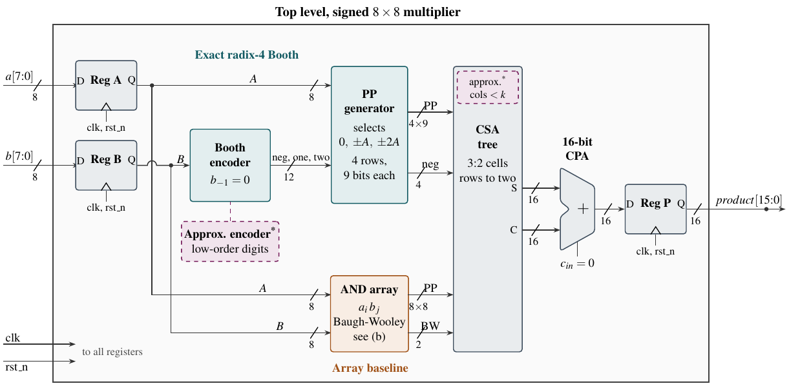
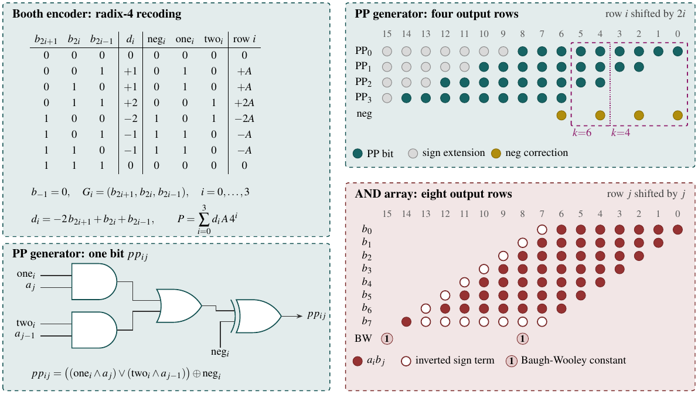
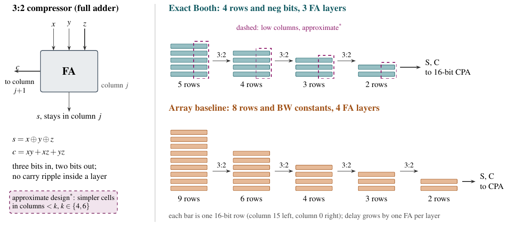

# 8-bit Signed Radix-4 Booth Multiplier

An 8-bit signed radix-4 Booth multiplier and a parallel array multiplier of the
same size, written in SystemVerilog and taken through the Synopsys flow in the
SAED 90 nm library. Both designs are compared on area, delay, power, and
power-delay product.



Booth encoding reads the multiplier two bits at a time, so it produces four
partial product rows instead of eight. The encoder and selector logic add some
cost back, so the project measures the net result instead of assuming it.

## Designs

Both designs share one top level, `mul.sv`, with the same ports, the same
registers, the same type of carry-save adder tree, and the same final adder.
Only the partial product stage differs, which keeps the comparison fair. The
Booth core is used by default. Defining `ARRAY` switches `mul.sv` to the
array core, so each design is built and run through the flow separately.

| design | partial products | rows | tree layers | how to select |
|---|---|---|---|---|
| Booth | radix-4 Booth encoder and selector | 4 plus a correction row | 3 | default |
| array | AND array with Baugh-Wooley terms | 8 plus a constant row | 4 | define `ARRAY` |

Ports: `clk`, `rst_n` (active low), signed `a[7:0]`, signed `b[7:0]`, signed
`product[15:0]`. Inputs and output are registered, so latency is two clocks.





## Folder layout

```
src/            design sources and the testbench
build/vcs-src/  RTL simulation is run here
build/dc-syn/   Design Compiler scripts, reports/ and output/ are created here
docs/           figures
results/        simulation logs and tool reports used for the results below
```

### Source files

| file | block in the top-level figure | used by |
|---|---|---|
| `mul.sv` | top level with Reg A, Reg B, Reg P | both |
| `booth_encoder.sv` | Booth encoder, one 3-bit group to `neg`, `one`, `two` | Booth |
| `booth_ppgen.sv` | PP generator, one 9-bit row | Booth |
| `csa_tree_booth.sv` | CSA tree, 5 rows to 2 in three layers | Booth |
| `booth_core.sv` | connects the encoders, PP generators, tree, and CPA | Booth |
| `array_core.sv` | AND array with Baugh-Wooley terms, tree, and CPA | array |
| `csa_tree_array.sv` | CSA tree, 9 rows to 2 in four layers | array |
| `csa32.sv` | one carry-save layer, three rows in and two out | both |
| `cpa16.sv` | final 16-bit carry-propagate adder | both |
| `mul_testbench.sv` | self-checking testbench | both |

## 1. Functional verification (VCS, RTL)

Booth design:

```
cd build/vcs-src
vcs -sverilog -full64 -debug_acc+all ../../src/csa32.sv ../../src/cpa16.sv ../../src/booth_encoder.sv ../../src/booth_ppgen.sv ../../src/csa_tree_booth.sv ../../src/booth_core.sv ../../src/mul.sv ../../src/mul_testbench.sv
./simv | tee booth_sim.log
```

Array baseline (note `+define+ARRAY`):

```
cd build/vcs-src
vcs -sverilog -full64 -debug_acc+all +define+ARRAY ../../src/csa32.sv ../../src/cpa16.sv ../../src/csa_tree_array.sv ../../src/array_core.sv ../../src/mul.sv ../../src/mul_testbench.sv
./simv | tee array_sim.log
```

The testbench first runs 12 corner cases, such as `-128 * -128` and
`64 * -2`, and prints each one. It then checks all 65,536 input pairs against
`a * b`. A passing run ends with:

```
checked 12 corner cases and 65536 pairs, 0 errors
All tests completed successfully
```

The corner cases are saved to `mul.dump` for viewing in DVE.

## 2. Synthesis (Design Compiler)

```
cd build/dc-syn
dc_shell -f booth_run-dc.tcl | tee booth_dc.log
dc_shell -f array_run-dc.tcl | tee array_dc.log
```

Reports go to `build/dc-syn/reports/` and the netlist to
`build/dc-syn/output/`. See [`build/dc-syn/README.md`](build/dc-syn/README.md).

## Results

Both designs pass the full test (12 corner cases and all 65,536 input pairs,
0 errors). Synthesis numbers come from `results/`, see
[`results/README.md`](results/README.md).

| design | area (um^2) | delay (ns) | power (uW) | PDP (pJ) |
|---|---|---|---|---|
| Booth | - | - | - | - |
| array | - | - | - | - |

Formality, post-synthesis simulation, IC Compiler, post-layout simulation, and
PrimeTime are the next steps.

## How the designs work

### Radix-4 Booth

Append `b[-1] = 0` to the multiplier and read overlapping groups
`(b[2i+1], b[2i], b[2i-1])`. Each group gives one digit
`d = -2*b[2i+1] + b[2i] + b[2i-1]` in `{-2,-1,0,+1,+2}`, so

```
product = sum over i of d[i] * a * 4^i
```

The encoder turns each digit into three control bits:

| group | digit | neg | one | two | row |
|---|---|---|---|---|---|
| 000 | 0 | 0 | 0 | 0 | 0 |
| 001 | +1 | 0 | 1 | 0 | +a |
| 010 | +1 | 0 | 1 | 0 | +a |
| 011 | +2 | 0 | 0 | 1 | +2a |
| 100 | -2 | 1 | 0 | 1 | -2a |
| 101 | -1 | 1 | 1 | 0 | -a |
| 110 | -1 | 1 | 1 | 0 | -a |
| 111 | 0 | 0 | 0 | 0 | 0 |

A negative digit inverts its row and adds a correction bit of 1 in column `2i`.
Those four correction bits form a fifth row into the tree.

### Baugh-Wooley array

For signed operands the AND array has partial products with a negative weight:
`a[7] & b[j]` and `a[i] & b[7]`. Using `-x * 2^k = ~x * 2^k - 2^k`, those terms
are inverted and the leftover constants add up to `2^15 + 2^8` modulo `2^16`,
which is the single constant row `16'h8100`.

### Reduction

Each `csa32` layer computes `s = x ^ y ^ z` and `c = (xy | xz | yz) << 1`, so a
carry never ripples inside a layer. Layers repeat until two rows are left, and
the 16-bit CPA adds them. Its carry-out is dropped, because a signed 8x8
product always fits in 16 bits.

## References

1. W. Liu, L. Qian, C. Wang, H. Jiang, J. Han, and F. Lombardi, "Design of
   approximate radix-4 Booth multipliers for error-tolerant computing," *IEEE
   Transactions on Computers*, vol. 66, no. 8, pp. 1435-1441, Aug. 2017.
2. W.-C. Yeh and C.-W. Jen, "High-speed Booth encoded parallel multiplier
   design," *IEEE Transactions on Computers*, vol. 49, no. 7, pp. 692-701,
   July 2000.
3. C. S. Wallace, "A suggestion for a fast multiplier," *IEEE Transactions on
   Electronic Computers*, vol. EC-13, no. 1, pp. 14-17, Feb. 1964.
4. C. R. Baugh and B. A. Wooley, "A two's complement parallel array
   multiplication algorithm," *IEEE Transactions on Computers*, vol. C-22,
   no. 12, pp. 1045-1047, Dec. 1973.
